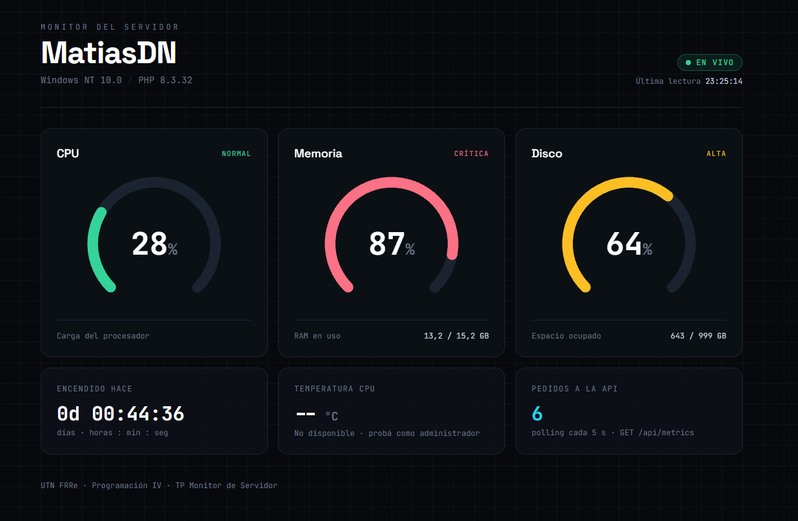
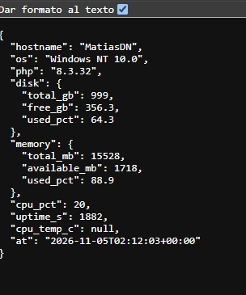
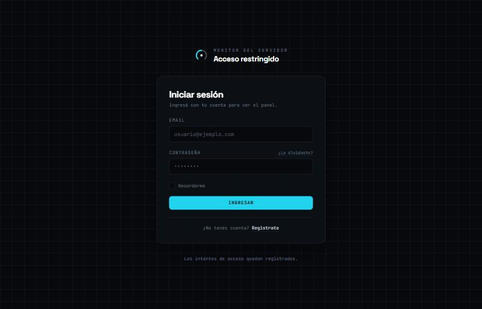
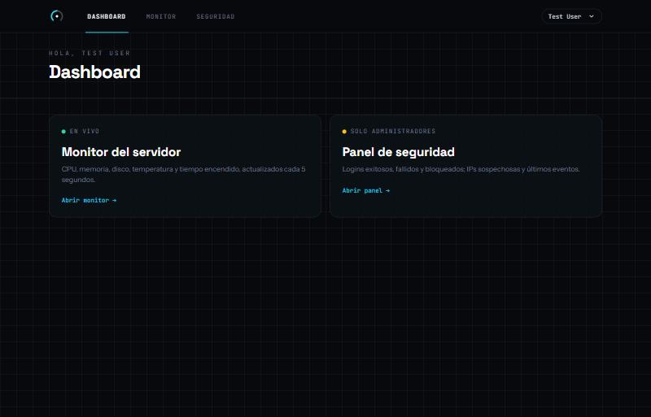
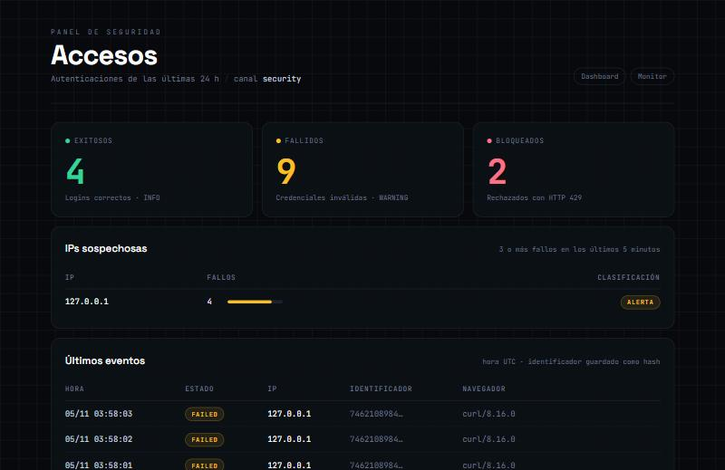

# Monitor de Servidor con Laravel

Trabajos prácticos de **Programación IV** (UTN FRRe, cohorte 2026).

Aplicación Laravel que lee datos del sistema operativo del servidor (nombre del equipo, sistema operativo, versión de PHP, disco, memoria, CPU, tiempo encendido y temperatura) y los muestra de dos formas:

- **Vista web** en `/servidor`, que se actualiza sola cada 5 segundos (polling).
- **API JSON** en `/api/metrics`.

Sobre ese mismo proyecto se integró después un módulo de **logging y detección de incidentes**: login con Laravel Breeze, registro de cada intento de acceso, alertas por fuerza bruta, bloqueo temporal por IP y un panel de seguridad para administradores.

| Trabajo práctico | Dónde está |
|---|---|
| Monitor de Servidor | rama `main` · [ver abajo](#tp-1--monitor-de-servidor) |
| Logging y detección de incidentes (proyecto iniciado) | rama `feature/security-logging` · [ver abajo](#tp-2--logging-y-detección-de-incidentes) · [informe completo](docs/TP2-logging-seguridad.md) |

## Entorno usado

| | |
|---|---|
| Sistema operativo | Windows 11 Pro |
| PHP | 8.3 |
| Laravel | 13 |
| Base de datos | SQLite |

## Cómo correrlo

```bash
composer install
cp .env.example .env
php artisan key:generate
php artisan migrate --seed
npm install
npm run build
php artisan serve
```

Los estilos están hechos con **Tailwind CSS** y se compilan con Vite. `npm run build` los genera una sola vez. Para trabajar sobre el diseño, usar `npm run dev` en otra terminal (recompila al guardar).

`--seed` crea dos usuarios de prueba (contraseña `password` en ambos):

| Usuario | Rol | Puede ver el panel de seguridad |
|---|---|---|
| `test@example.com` | Administrador | Sí |
| `comun@example.com` | Común | No (recibe 403) |

### Rutas

| Ruta | Acceso | Qué muestra |
|---|---|---|
| `/servidor` | Público | Monitor con medidores en vivo |
| `/api/metrics` | Público (máx. 60 pedidos/min) | Datos del servidor en JSON |
| `/login`, `/register` | Invitados | Acceso con Breeze |
| `/dashboard` | Usuarios logueados | Acceso al monitor y al panel |
| `/security-dashboard` | Solo administradores | Panel de seguridad |
| `/security-dashboard/export` | Solo administradores | Descarga de evidencias en CSV |

---

## TP 1 · Monitor de Servidor

### Estructura

| Parte | Archivo | Responsabilidad |
|---|---|---|
| Service | `app/Services/ServerMetrics.php` | Lee los datos del sistema operativo (PHP + PowerShell/WMI) |
| Controlador | `app/Http/Controllers/ServerController.php` | Devuelve la vista o el JSON |
| Vista | `resources/views/servidor.blade.php` | Muestra los medidores y hace el polling |
| Estilos | `resources/css/app.css` | Paleta, fuentes y fondo del panel (Tailwind) |
| Rutas | `routes/web.php`, `routes/api.php` | `/servidor` y `/api/metrics` (con `throttle:60,1`) |

### Capturas

#### Vista `/servidor`



#### Respuesta de `/api/metrics`



### Respuestas

#### 1. ¿Por qué la temperatura suele aparecer como "No disponible" en Windows?

La clase `MSAcpi_ThermalZoneTemperature` del namespace `root/wmi` necesita permisos de administrador. Si la terminal donde corre `php artisan serve` no se abrió como administrador, la consulta falla, entra al `catch` y la temperatura queda en `null`. Además, aunque se ejecute como administrador, muchas placas madre no informan su temperatura por ACPI, o informan la de una "zona térmica" que no es la de la CPU.

<!-- Completar con lo que pasó al probar como administrador -->

#### 2. ¿Por qué el script de PowerShell nunca debe incluir datos que vengan del usuario?

Porque `shell_exec()` ejecuta comandos en el sistema operativo con los permisos del proceso de PHP. Si se armara el script con datos de un formulario o de la URL, alguien podría mandar un texto con comandos propios (por ejemplo, cortar el comando con `;` y agregar otro) y ejecutar cualquier cosa en el servidor: borrar archivos, leer credenciales, instalar programas. Esto se llama **inyección de comandos**. Por eso el script es fijo y no recibe ningún dato externo.

#### 3. ¿Qué riesgo tiene dejar `/api/metrics` sin autenticación en un servidor real?

Cualquiera puede ver información de la infraestructura: nombre del equipo, sistema operativo, versión de PHP y uso de recursos. Esos datos le sirven a un atacante para buscar vulnerabilidades conocidas de esas versiones o para saber cuándo el servidor está más cargado. Además, como cada pedido abre PowerShell y es costoso, alguien podría llamarla muchas veces seguidas para sobrecargar el servidor (el `throttle:60,1` limita esto, pero no lo elimina). En producción habría que protegerla, por ejemplo con `auth:sanctum`.

#### 4. Con polling cada 5 segundos, ¿cuántos pedidos por minuto recibe el servidor si hay 50 personas mirando?

Cada persona hace 60 / 5 = **12 pedidos por minuto**. Con 50 personas: 50 × 12 = **600 pedidos por minuto**, aunque los datos no hayan cambiado. Y cada pedido abre un proceso de PowerShell.

#### 5. Si una app solo necesita la temperatura, ¿qué datos recibe de más al llamar a `/api/metrics`?

Recibe todo el resto: `hostname`, `os`, `php`, `disk` (con `total_gb`, `free_gb` y `used_pct`), `memory` (con `total_mb`, `available_mb` y `used_pct`), `cpu_pct`, `uptime_s` y `at`. Esto se llama **over-fetching**, y es el problema que resuelve GraphQL: el cliente pide solo los campos que necesita.

---

## TP 2 · Logging y detección de incidentes

Integración sobre este mismo proyecto, **sin reemplazar el login existente**: se escuchan los eventos de autenticación de Laravel y se agrega un middleware antes de la ruta de login. El detalle de pruebas, consultas, análisis y decisiones está en el **[informe del TP](docs/TP2-logging-seguridad.md)**.

### Reglas de detección

| Condición (por IP, en 5 minutos) | Respuesta |
|---|---|
| Login correcto | `INFO` + registro `success` |
| 1 o 2 fallos | `WARNING` + registro `failed` |
| 3 o 4 fallos | `ALERT` por posible fuerza bruta |
| 5 fallos | Bloqueo de 10 minutos + `CRITICAL` |
| IP bloqueada | HTTP 429 + registro `blocked` |

Los eventos se guardan en la tabla `login_attempts` (el email se guarda como hash SHA-256) y en `storage/logs/security-AAAA-MM-DD.log`.

### Mejoras (actividad integradora)

- **Detección por cuenta:** también se cuentan los fallos contra la misma cuenta desde cualquier IP (ventana de 15 minutos). Con 3 hay alerta y con 5 la cuenta se bloquea 10 minutos para todas las IPs. Detecta ataques distribuidos que las reglas por IP no ven.
- **Exportación de evidencias:** botón *Exportar CSV* en el panel. Solo para administradores, y cada descarga queda registrada en el log.

Las dos están cubiertas por tests automáticos (`php artisan test`).

### Estructura

| Parte | Archivo | Responsabilidad |
|---|---|---|
| Autenticación | Laravel Breeze (Blade) | Login, registro y perfil, adaptados al estilo del monitor |
| Canal de logs | `config/logging.php` | Canal `security`, diario, nivel `info`, 30 días |
| Tabla | `database/migrations/..._create_login_attempts_table.php` | Auditoría de intentos |
| Listener | `app/Listeners/RecordSecurityAuthentication.php` | Registra los eventos `Login` y `Failed` |
| Middleware | `app/Http/Middleware/SecurityLoginGuard.php` | Alerta y bloqueo por IP y por cuenta, aplicado solo a `POST /login` |
| Permiso | `app/Providers/AppServiceProvider.php` | Gate `viewSecurityDashboard` (usuarios con `is_admin`) |
| Panel | `app/Http/Controllers/SecurityDashboardController.php` | Indicadores de 24 h, IPs sospechosas, cuentas atacadas, últimos eventos y exportación CSV |
| Tests | `tests/Feature/SecurityModuleTest.php` | Reglas por IP y las dos mejoras |

### Capturas

#### Login



#### Dashboard



#### Panel de seguridad

Demostración con 4 intentos fallidos desde la misma IP: aparece como sospechosa con clasificación **Alerta** (con 5 pasaría a **Crítico** y se bloquearía).


