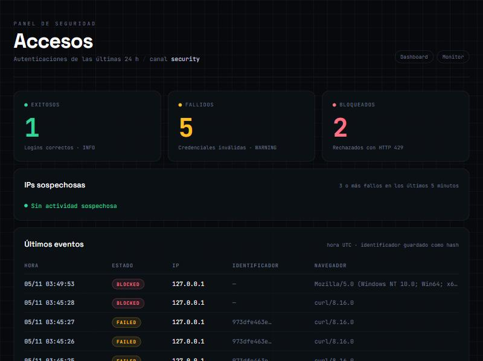

# TP · Logging y detección de incidentes (proyecto iniciado)

Integración de registro de autenticaciones, detección de patrones sospechosos y bloqueo temporal **sobre el proyecto existente** *Monitor de Servidor*, sin reemplazar su login.

- **Rama de trabajo:** `feature/security-logging`
- **Laravel:** 13.40.0 · **Base de datos:** SQLite · **Caché:** `database` (persistente)

## 1. Autenticador y punto de integración

| | |
|---|---|
| Autenticador | **Laravel Breeze** (stack Blade), que usa `Auth::attempt()` en `App\Http\Requests\Auth\LoginRequest` |
| Ruta de login | `POST /login` → `Auth\AuthenticatedSessionController@store`, definida en `routes/auth.php` |
| Middleware integrado en | esa misma ruta: `->middleware(SecurityLoginGuard::class)` en `routes/auth.php` |
| Registro de eventos | listener sobre los eventos estándar `Login` y `Failed` que emite el guard de Laravel |

El monitor no tenía login, así que se agregó Breeze en la misma rama antes de integrar el módulo. El login de Breeze **no se modificó**: el listener solo observa sus eventos y el middleware actúa antes del controlador.

## 2. Archivos agregados o modificados

| Archivo | Qué hace |
|---|---|
| `config/logging.php` | Canal `security` (diario, nivel `info`, 30 archivos) sin tocar los canales existentes |
| `database/migrations/..._create_login_attempts_table.php` | Tabla de auditoría con índice `(ip_address, status, created_at)` |
| `app/Models/LoginAttempt.php` | Modelo de la tabla |
| `app/Listeners/RecordSecurityAuthentication.php` | Registra `success` / `failed` en la tabla y en el log |
| `app/Http/Middleware/SecurityLoginGuard.php` | Alerta con 3 fallos, bloquea con 5, responde 429 si la IP está bloqueada |
| `routes/auth.php` | Aplica el middleware solo a `POST /login` |
| `database/migrations/..._add_is_admin_to_users_table.php` | Rol mínimo de administrador |
| `app/Providers/AppServiceProvider.php` | Gate `viewSecurityDashboard` |
| `app/Http/Controllers/SecurityDashboardController.php` | Indicadores, IPs sospechosas y últimos eventos |
| `resources/views/security-dashboard.blade.php` | Panel `/security-dashboard` (requiere `auth` + `can:viewSecurityDashboard`) |
| `tests/TestCase.php` | Durante los tests, el canal `security` descarta los mensajes para no ensuciar la evidencia |
| `database/migrations/..._add_identifier_index_to_login_attempts_table.php` | Índice para la detección por cuenta (mejora 1) |
| `tests/Feature/SecurityModuleTest.php` | Tests automáticos del módulo y de las dos mejoras |

### Diferencias con el enunciado

- **Listener registrado por auto-discovery.** `php artisan event:list` mostró que Laravel ya lo asocia a `Login` y `Failed` por el tipo del parámetro de `handle()`. Registrarlo además con `Event::listen` en `AppServiceProvider` habría duplicado cada registro, y con 3 fallos reales se habría contado 6.
- **`max_files` en lugar de `days`** en el canal diario: es el nombre actual de la opción en Laravel 13 (la clave anterior sigue funcionando).
- **Middleware en `routes/auth.php`** y no en `routes/web.php`: es donde Breeze define la ruta de login.
- **Consultas en sintaxis SQLite** (`datetime('now', '-5 minutes')`) en lugar de MySQL (`NOW() - INTERVAL 5 MINUTE`).
- **`is_admin` no es asignable en masa** (no figura en `Fillable` del modelo `User`), para que nadie pueda hacerse administrador desde un formulario.

## 3. Pruebas obligatorias

Se partió de la tabla vacía y un log nuevo. Todas las pruebas se hicieron en entorno local con usuarios de prueba (`test@example.com`).

| # | Prueba | Resultado esperado | Resultado obtenido |
|---|---|---|---|
| 1 | Login válido | INFO y registro `success` | ✅ HTTP 302 → `/dashboard` · `INFO Authentication success` · fila `success` |
| 2 | Dos contraseñas incorrectas | Dos WARNING y dos registros `failed` | ✅ 2 × HTTP 302 → `/login` · 2 × `WARNING Authentication failed` · 2 filas `failed` |
| 3 | Tres fallos en cinco minutos | ALERT en el intento siguiente | ✅ En el 4.º intento: `ALERT Possible brute force {"failures":3}` |
| 4 | Cinco fallos en cinco minutos | Bloqueo de 10 minutos en el intento siguiente | ✅ En el 6.º intento: HTTP **429** · `CRITICAL Temporary IP block {"failures":5}` |
| 5 | Acceso con IP bloqueada | HTTP 429; evento `blocked` | ✅ HTTP **429** aun con la contraseña correcta · `WARNING Blocked login attempt` · fila `blocked` |
| 6 | Después de diez minutos | Vuelve a admitirse el intento | ✅ A las 03:56:12 (bloqueo desde 03:45:28): HTTP 302 → `/dashboard` · `INFO Authentication success` |

El flujo de login de Breeze sigue funcionando: sus 25 tests pasan después de la integración.

Durante la espera de la prueba 6 también quedaron registrados dos accesos reales desde un navegador (Mozilla, Windows): uno a las 03:49:53, rechazado con 429 porque la IP seguía bloqueada, y otro a las 03:56:00, exitoso apenas venció el bloqueo.

### Log generado (`storage/logs/security-2026-11-05.log`, horas en UTC)

Copia completa en [`evidencias/security-2026-11-05.log`](evidencias/security-2026-11-05.log).

```
[2026-11-05 03:45:23] local.INFO: Authentication success {"ip":"127.0.0.1","guard":"web"}        ← prueba 1
[2026-11-05 03:45:23] local.WARNING: Authentication failed {"ip":"127.0.0.1","guard":"web"}      ← prueba 2 (fallo 1)
[2026-11-05 03:45:24] local.WARNING: Authentication failed {"ip":"127.0.0.1","guard":"web"}      ← prueba 2 (fallo 2)
[2026-11-05 03:45:25] local.WARNING: Authentication failed {"ip":"127.0.0.1","guard":"web"}      ← prueba 3 (fallo 3)
[2026-11-05 03:45:26] local.ALERT: Possible brute force {"ip":"127.0.0.1","failures":3}          ← prueba 3 (intento siguiente)
[2026-11-05 03:45:26] local.WARNING: Authentication failed {"ip":"127.0.0.1","guard":"web"}
[2026-11-05 03:45:27] local.ALERT: Possible brute force {"ip":"127.0.0.1","failures":4}          ← prueba 4 (fallo 5)
[2026-11-05 03:45:27] local.WARNING: Authentication failed {"ip":"127.0.0.1","guard":"web"}
[2026-11-05 03:45:28] local.CRITICAL: Temporary IP block {"ip":"127.0.0.1","failures":5}         ← prueba 4 (bloqueo, HTTP 429)
[2026-11-05 03:45:28] local.WARNING: Blocked login attempt {"ip":"127.0.0.1"}                    ← prueba 5 (HTTP 429)
[2026-11-05 03:49:53] local.WARNING: Blocked login attempt {"ip":"127.0.0.1"}                    ← acceso desde navegador, bloqueado
[2026-11-05 03:56:00] local.INFO: Authentication success {"ip":"127.0.0.1","guard":"web"}        ← acceso desde navegador, ya sin bloqueo
[2026-11-05 03:56:12] local.INFO: Authentication success {"ip":"127.0.0.1","guard":"web"}        ← prueba 6
```

## 4. Resultados de las consultas

```sql
-- Últimos eventos
SELECT id, status, ip_address, created_at
FROM login_attempts ORDER BY created_at DESC, id DESC LIMIT 20;
```

| id | status | ip_address | created_at (UTC) |
|---|---|---|---|
| 7 | blocked | 127.0.0.1 | 2026-11-05 03:45:28 |
| 6 | failed | 127.0.0.1 | 2026-11-05 03:45:27 |
| 5 | failed | 127.0.0.1 | 2026-11-05 03:45:26 |
| 4 | failed | 127.0.0.1 | 2026-11-05 03:45:25 |
| 3 | failed | 127.0.0.1 | 2026-11-05 03:45:24 |
| 2 | failed | 127.0.0.1 | 2026-11-05 03:45:23 |
| 1 | success | 127.0.0.1 | 2026-11-05 03:45:23 |

```sql
-- Fallos acumulados por IP
SELECT ip_address, COUNT(*) AS total_fallos
FROM login_attempts WHERE status = 'failed'
GROUP BY ip_address ORDER BY total_fallos DESC;
```

| ip_address | total_fallos |
|---|---|
| 127.0.0.1 | 5 |

```sql
-- IPs sospechosas: 3 o más fallos en los últimos 5 minutos (SQLite)
SELECT ip_address, COUNT(*) AS total_fallos
FROM login_attempts
WHERE status = 'failed' AND created_at >= datetime('now', '-5 minutes')
GROUP BY ip_address HAVING COUNT(*) >= 3
ORDER BY total_fallos DESC;
```

| ip_address | total_fallos |
|---|---|
| 127.0.0.1 | 5 |

## 5. Panel de monitoreo

`/security-dashboard` muestra los totales `success`, `failed` y `blocked` de las últimas 24 horas, las IPs con 3 o más fallos en 5 minutos (clasificadas como *Alerta* o *Crítico*) y los últimos eventos. Solo pueden verlo usuarios con `is_admin = true`:

| Quién | Resultado |
|---|---|
| Invitado | 302 → `/login` |
| Usuario común | **403** y no ve el link "Seguridad" en el menú |
| Administrador | 200 |

Captura tomada a las 03:49 UTC, después de las pruebas 1 a 5 (los fallos ya habían salido de la ventana de 5 minutos, por eso no figuran IPs sospechosas):



## 6. Análisis y toma de decisiones

<!-- Revisar y escribir con palabras propias -->

**¿Qué IP concentra más fallos?**
127.0.0.1, con 5 fallos en menos de 5 segundos sobre la misma cuenta.

**¿Puede afirmarse que existe un ataque?**
No con certeza. El patrón (muchos fallos seguidos, a intervalos de un segundo, con un cliente automatizado como `curl`) es compatible con fuerza bruta, pero también podría ser un usuario que olvidó su contraseña o un script mal configurado. Los logs permiten **detectar un comportamiento sospechoso**, no probar una intención. Para afirmarlo harían falta más evidencias.

**¿Qué consecuencias tendría bloquear una IP compartida?**
Detrás de una misma IP pública puede haber muchas personas: una universidad, una empresa, un proveedor que usa CGNAT o una red móvil. Bloquearla por los fallos de uno deja afuera a todos los demás durante 10 minutos (denegación de servicio para usuarios legítimos). Además, un atacante podría provocarlo a propósito. Por eso conviene combinar límites por IP con límites por cuenta.

**¿Qué otros indicadores usaría el equipo de seguridad?**
- Cantidad de cuentas distintas intentadas desde una misma IP (*password spraying*).
- Fallos sobre una misma cuenta desde muchas IPs distintas (ataque distribuido).
- User-agent: clientes automatizados (`curl`, scripts) frente a navegadores.
- Horario y frecuencia de los intentos, comparados con el uso habitual.
- Geolocalización o reputación de la IP.
- Un login exitoso justo después de una serie de fallos (posible cuenta comprometida).

**¿Qué acciones deben ser automáticas y cuáles requieren revisión humana?**
- *Automáticas:* registrar todos los eventos, alertar al superar umbrales, aplicar bloqueos **temporales** y cortos que se levantan solos.
- *Con revisión humana:* bloqueos permanentes, bloquear o deshabilitar una cuenta, decidir si hubo un incidente real, contactar al usuario afectado o denunciarlo.

## 7. Actividad integradora: dos mejoras

### Mejora 1 · Detección por cuenta

**Problema que resuelve.** Las reglas por IP no detectan un ataque **distribuido**: si cada intento llega desde una IP distinta (proxies, botnet), ninguna IP llega a 5 fallos y la cuenta puede ser atacada sin límite. Además, el bloqueo por IP castiga a todos los que comparten esa IP.

**Cómo funciona.** `SecurityLoginGuard` cuenta también los fallos contra la **misma cuenta** (mismo `identifier_hash`, es decir, el hash del email) desde **cualquier IP**, en una ventana de **15 minutos**. La ventana es más larga que la de IP porque los ataques distribuidos suelen ser más lentos.

| Fallos contra la cuenta (15 min) | Respuesta |
|---|---|
| 3 o 4 | `ALERT Possible targeted attack on account` (con la cantidad de IPs distintas) |
| 5 | Cuenta bloqueada 10 minutos para todas las IPs · `CRITICAL Temporary account lock` · HTTP 429 |
| Cuenta bloqueada | HTTP 429 · `WARNING Blocked login attempt (locked account)` · fila `blocked` |

- Se agregó el índice `(identifier_hash, status, created_at)` en una migración nueva para que la consulta sea rápida.
- El panel suma la tabla **Cuentas atacadas**, con la cantidad de fallos y de **IPs distintas**; si son 2 o más, se marca como *distribuido*.
- El bloqueo de una cuenta no afecta a las demás.

**Trade-off.** Un atacante podría bloquear a propósito la cuenta de otra persona fallando 5 veces (denegación de servicio dirigida). Por eso el bloqueo es corto y temporal, y conviene combinarlo con avisos al dueño de la cuenta.

### Mejora 2 · Exportación de evidencias

**Problema que resuelve.** Para analizar un incidente fuera del sistema (planilla, informe, otra herramienta) o entregarlo como evidencia hace falta sacar los datos de forma ordenada.

**Cómo funciona.** El botón **Exportar CSV** del panel (`GET /security-dashboard/export`) descarga todos los intentos con `id`, fecha UTC, estado, IP, hash del identificador y navegador.

- Tiene la misma protección que el panel: `auth` + `can:viewSecurityDashboard`.
- Se genera con `streamDownload` y `lazy()`: se escribe por partes, sin cargar toda la tabla en memoria.
- Incluye BOM UTF-8 para que Excel muestre bien los caracteres.
- **La exportación queda registrada**: `NOTICE Security evidence exported` con el usuario, la IP y la cantidad de filas. Quién accede a los datos de auditoría también se audita.

### Tests automáticos

`tests/Feature/SecurityModuleTest.php` (9 tests, todos pasan junto a los 25 de Breeze):

| Test | Verifica |
|---|---|
| Login correcto | Registra `success` |
| Cinco fallos desde una IP | El sexto intento da 429, incluso con la contraseña correcta |
| Ataque distribuido | 5 IPs con 1 fallo cada una bloquean la cuenta; una IP nueva recibe 429 |
| Tres fallos contra una cuenta | Alerta, pero se puede entrar con la contraseña correcta |
| Bloqueo aislado | Bloquear una cuenta no afecta a otra |
| Panel | Muestra la cuenta atacada marcada como *distribuido* |
| Exportación | Invitado → login · usuario común → 403 · admin → CSV con los datos |

Las IPs se simulan con `REMOTE_ADDR`, así se reproduce un ataque distribuido sin varias máquinas.

## 8. Decisión de seguridad adoptada

Se aplica un **bloqueo temporal de 10 minutos por IP** después de 5 fallos en 5 minutos, con alertas desde el tercer fallo. Es una medida automática, reversible y de impacto acotado, que frena la fuerza bruta simple sin depender de una persona. La decisión de ir más allá queda para revisión humana con la evidencia del log y del panel.

### Límites conocidos

- La evaluación se hace **antes** de cada intento: el quinto fallo se registra y recién el sexto intento se bloquea (detección frente a bloqueo en tiempo real).
- El intento que dispara el bloqueo se registra en el log como `CRITICAL`, pero no genera una fila `blocked` en la tabla; los siguientes sí.
- No es atómico: muchos intentos concurrentes podrían pasar antes de que se cuenten.
- La detección por cuenta (mejora 1) cubre los ataques distribuidos contra una cuenta, pero no el *password spraying*: una misma contraseña probada contra muchas cuentas distintas, con pocos intentos por cuenta.
- Breeze trae su propio limitador (5 intentos por email + IP). Convive con este módulo, pero el middleware corta antes.
- En producción habría que configurar proxies confiables para obtener la IP real del cliente, usar `RateLimiter`/Redis y definir una política de retención de logs.
